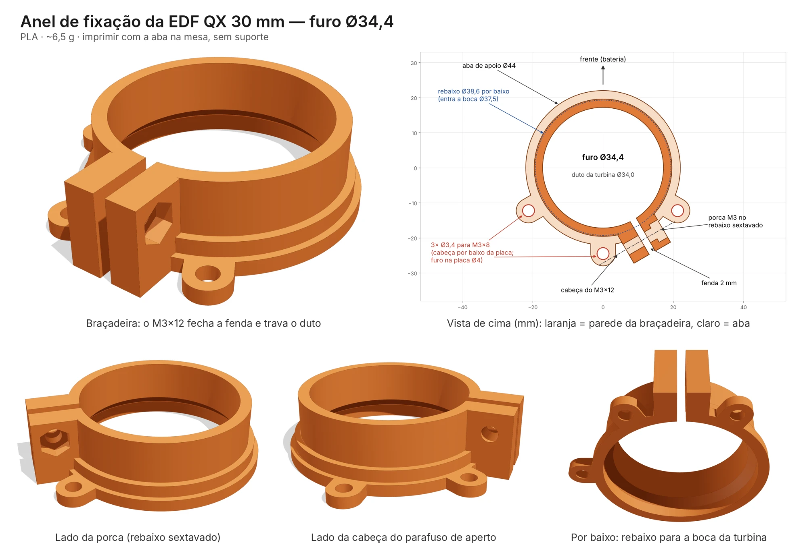

# Mecânica — peças para imprimir e montar

| Seção | O que tem |
|---|---|
| [O que imprimir](#o-que-imprimir) | STL de `stl/`, quantidades e versões |
| [Configuração de impressão](#configuração-de-impressão) | como colocar cada peça na mesa |
| [Ferragens](#ferragens) | parafusos e porcas |
| [Ordem de montagem](#ordem-de-montagem) | anel da EDF e braços da barra |
| [Gerar de novo](#gerar-de-novo) | scripts de `scripts/` |

Referências usadas nos scripts: base de fenolite de 1,5 mm, motores por cima da placa, rodas de Ø22 mm (face de cima da placa a ~6,0 mm do chão). Ângulos do anel: 0° = direita (+x), 90° = frente (+y, lado da barra e da bateria).

## O que imprimir
Tudo em PLA.

| Arquivo (`stl/`) | Qtde | Função |
|---|---|---|
| `anel_edf_qx30_furo34.4.stl` | 1 | anel de fixação da EDF QX-Motor 30 mm, furo Ø34,4, sem entalhe (a versão da figura abaixo) |
| `anel_edf_qx30_A_furo34.3.stl` | 1 | o mesmo anel com furo Ø34,3, 1 entalhe de identificação na orelha |
| `anel_edf_qx30_B_furo34.5.stl` | 1 | o mesmo anel com furo Ø34,5, 2 entalhes |
| `placa_impressao_anel_A_e_B.stl` | — | A e B lado a lado, para imprimir os dois de uma vez |
| `bracos_barra_12cm_M2.5_M2.stl` | 1 par | braços da barra, 120 mm, furos para a barra de 50 a 110 mm a cada 10 mm |
| `bracos_barra_M2.5_M2.stl` | 1 par | versão longa: furos de 50 a 185 mm a cada 5 mm |
| patins | — | **falta**: o `gerar_patins.py` ainda não está no repositório |

- O corpo do duto da EDF mede Ø34,0 (folha de dados = medido). O anel A aperta mais que o B; o de 34,4 fica no meio. Imprimir um, testar o encaixe e só então escolher.
- Cada anel pesa ~6,5 g em PLA. Os braços: 11,4 g (12 cm) ou 16,9 g (longo), maciços.
- Os números na lateral dos braços são a distância do furo da placa ao furo da barra, em cm.
- `anel_turbina_placa.dxf`: furo Ø38 da turbina, os 3 furos Ø4 das abas e o contorno do anel, para a placa (ver `eletronica/fabricacao/`).



## Configuração de impressão
- **Anel:** com a aba na mesa, sem suporte (o rebaixo da boca da turbina tem chanfro de 45°).
- **Braços:** já saem na posição de impressão: face de cima do braço na mesa, batente para cima, sem suporte.
- Os furos já têm folga para o PLA: Ø3,4 nas abas do anel (M3), Ø3,5 no aperto, Ø2,9 no pé dos braços (M2,5) e Ø2,4 nos furos da barra (M2; a impressora fecha uns 0,1–0,2 mm).
- Sugestão, a conferir na primeira peça: bico de 0,4 mm, camada de 0,16–0,2 mm, 4 perímetros e preenchimento alto no anel (a orelha trabalha sob o aperto do M3×12).

## Ferragens
| Item | Qtde | Onde |
|---|---|---|
| Parafuso M3 × 8 | 3 | abas do anel: cabeça por baixo da placa |
| Porca M3 parlock | 3 | em cima das abas |
| Parafuso M3 × 12 | 1 | aperto da braçadeira (orelha do anel) |
| Porca M3 | 1 | presa no rebaixo sextavado da orelha |
| Parafuso M2,5 × 8 + porca | 2 | pé dos braços nos furos da frente da placa (45,98 mm entre furos) |
| Parafuso M2 + porca | 2 | barra nos braços (braço de 4 mm + barra de 1,6 mm + porca: ~8 mm) |

## Ordem de montagem
**Anel da EDF** (pela geometria do `gerar_anel.py`):
1. Furar a placa pelo DXF: Ø38 para a turbina e 3× Ø4 para as abas.
2. Testar o anel no duto antes de montar: tem de entrar justo e travar com o M3×12.
3. Pôr a porca M3 no rebaixo sextavado da orelha.
4. Apoiar o anel na placa (aba na face de cima) e colocar os 3 M3×8 por baixo, com as parlock **sem apertar**.
5. Encaixar a EDF por baixo da placa, pelo furo de Ø38, até a boca alargada (Ø37,5) assentar no rebaixo do anel. A entrada da turbina fica a ~2 mm do chão.
6. Apertar o M3×12: a braçadeira fecha e puxa as abas (até ~0,5 mm no A, ~0,8 mm no B; os furos de Ø4 da placa dão essa folga).
7. Só então apertar as 3 parlock.

**Braços da barra:**
1. Pé de cada braço no furo da frente da placa, com M2,5 × 8. O furo do pé é oblongo (±0,6 mm): empurrar o braço para trás até o batente encostar na borda da frente da placa e apertar. O batente impede o braço de girar.
2. Barra nos dois braços, no mesmo furo dos dois lados, com M2. Os 12 sensores ficam à frente dos furos da barra.
3. Ligar o cabo da barra no conector 1×8 da placa (ordem em `eletronica/README.md`).

Falta escrever: motores e rodas, bateria, patins e a passagem dos cabos.

## Gerar de novo
Precisa de `numpy`, `shapely`, `trimesh`, `manifold3d`, `matplotlib` e, para o DXF, `ezdxf`.

```bash
pip install numpy shapely trimesh manifold3d matplotlib ezdxf
```

```bash
python3 mecanica/scripts/gerar_anel.py
```

```bash
python3 mecanica/scripts/gerar_bracos.py
```

Os dois gravam em `mecanica/stl/` (o do anel aceita outra pasta como argumento; o dos braços aceita `longo` ou `12cm` para gerar só uma versão). As medidas de entrada estão no começo de cada script. Os arquivos de referência que os scripts também gravam (`bracos_montados_referencia*.stl`, braços na posição montada, e `anel_2d.json`) ficam fora do git.

Os STL atuais saíram desses scripts e são idênticos, byte a byte, aos enviados em 17/11/2026: o anel de 34,4 (variante `figura` do `gerar_anel.py`: folga 0,4, sem entalhe) e os braços de 12 cm. O DXF muda só a data e os identificadores internos a cada execução.
